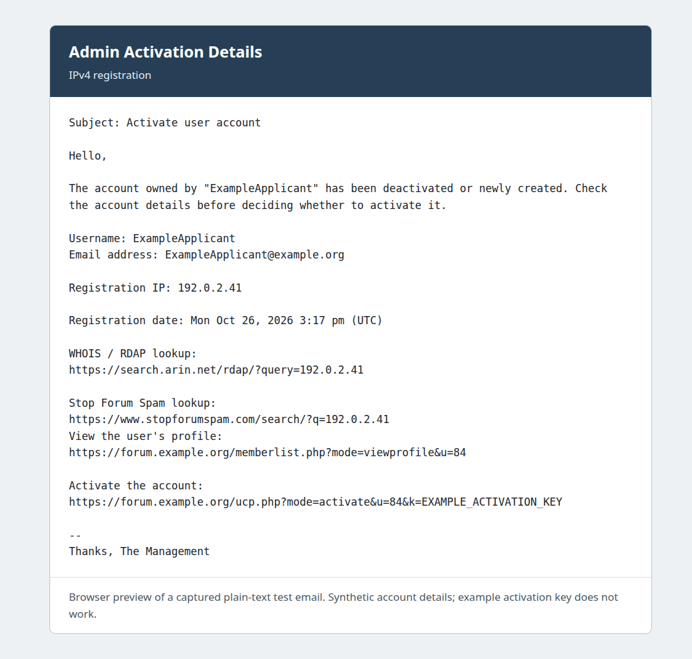
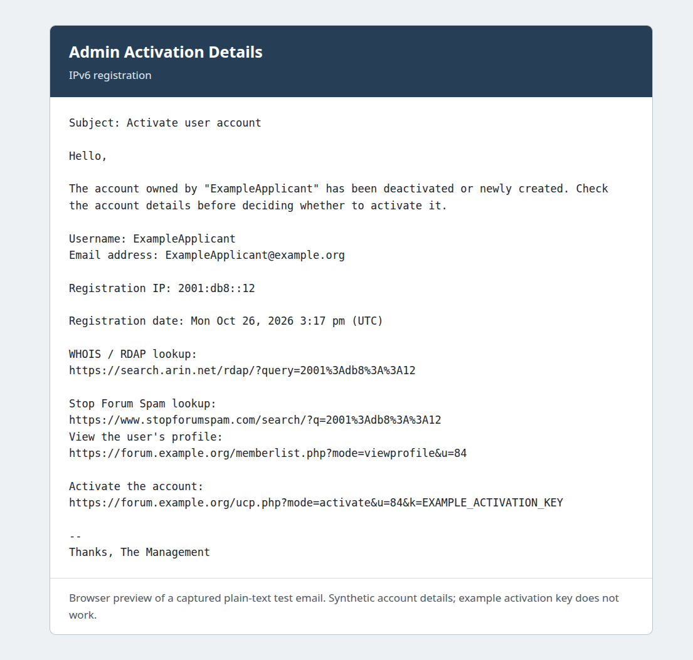
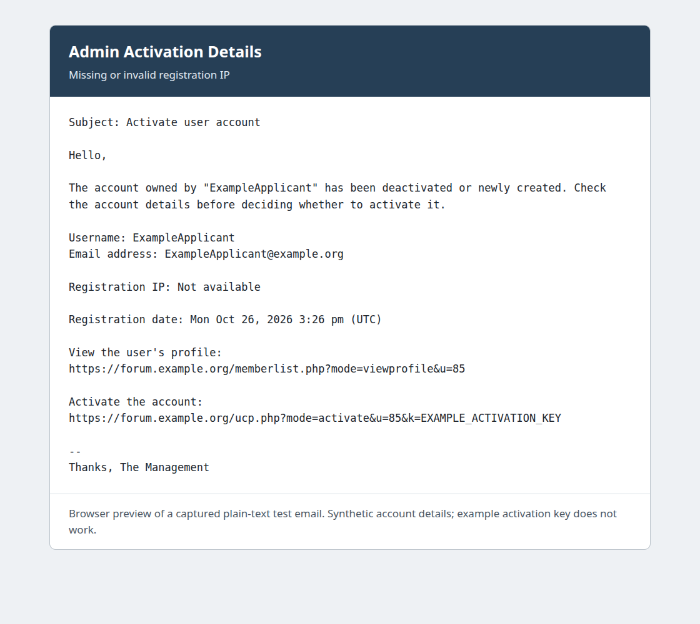

# Email examples

Browser previews of captured plain-text test emails. All account details are
synthetic, and the example activation keys do not work. These previews show the
email contents; the surrounding frame is not part of the sent email.

### IPv4 registration

### IPv6 registration

### Missing or invalid IP

